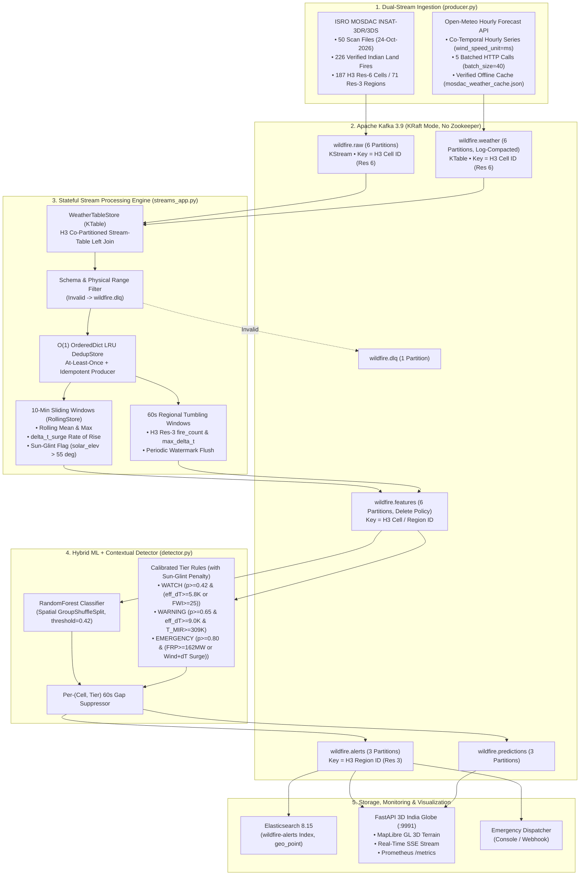

# ISRO MOSDAC & Open-Meteo Real-Time Wildfire Stream Processing Pipeline

**Course**: Stream Processing and Analytics (SPA)  
**Branch**: `feat-india-mosdac-pipeline`  
**Target Domain**: Indian Terrestrial Sector ($6.5^\circ\text{N} - 37.5^\circ\text{N}, 68.0^\circ\text{E} - 97.5^\circ\text{E}$, land-masked)  
**Core Technologies**: Apache Kafka (KRaft Mode), Uber H3 Hexagonal Spatial Partitioning, Python Streaming Topology (`WeatherTableStore` KTable + `RollingStore` + `TumblingWindows`), Scikit-Learn (`RandomForestClassifier` with spatial `GroupShuffleSplit`), MapLibre GL 3D Satellite Globe, FastAPI, Elasticsearch.

---

## 1. Executive Summary & Architecture

Satellite thermal detection and meteorological fire-weather analytics address complementary aspects of wildfire monitoring:
1. **Satellite Radiometry (Thermal Anomaly Detection)**: Identifies sub-pixel active combustion from Mid-Wave Infrared ($3.9\,\mu\text{m}$) and Thermal Infrared ($10.8\,\mu\text{m}$) brightness temperatures.
2. **Atmospheric Meteorology (Fire Weather & False-Alarm Filtering)**: Quantifies atmospheric dryness, wind velocity, soil moisture, and vapor pressure deficit (VPD) to separate genuine wildfires under dry/windy conditions from daytime solar-heated bare soil/rock glint under humid or calm conditions.

This pipeline implements a **dual-topic, H3-co-partitioned stream processing architecture**:
- **`wildfire.raw` (KStream)**: Carries ISRO MOSDAC INSAT-3DR/3DS satellite thermal observations keyed by Uber H3 Resolution 6 cell ID (`cell_id`).
- **`wildfire.weather` (Log-Compacted KTable)**: Carries Open-Meteo hourly meteorological updates (wind speed in $\text{m/s}$) keyed by the same H3 Resolution 6 `cell_id`.
- **`streams_app.py` (`WeatherTableStore`)**: Consumes both topics, materializes the in-memory weather KTable, performs a **shuffle-free H3 Stream-Table Left Join**, applies schema/range validation, $O(1)$ `OrderedDict` LRU deduplication, median imputation, 10-minute sliding-window surge computation (`delta_t_surge`), and 60-second regional tumbling-window aggregations (`fire_count`, `max_delta_t`) with periodic watermark flushing.



---

## 2. ISRO MOSDAC Satellite Data Deep-Dive

### 2.1 Supported MOSDAC Data Products
1. **Level-2P Active Fire Hotspots (`3RIMG_24OCT2026_HHMM_L2P_FIR_V01R00.kml`)**:
   - Geostationary active fire detections produced by ISRO's Space Applications Centre (SAC). Each `<Placemark>` represents an active fire pixel (~$4\text{ km} \times 4\text{ km}$ at sub-satellite point) detected by ISRO's contextual fire algorithm.
   - `MOSDAC Data/Fire/` contains 50 KML files from 24-Oct-2026 (including a duplicate scan slot `0015`/`0016` and an acquisition gap between `16:45` and `20:45 UTC`; fire detections occur primarily between `03:00–16:00 UTC` and `21:00–22:00 UTC`, peaking at `05:00–08:00 UTC` / `10:30–13:30 IST`).
   - Across the full geostationary disc there are 3,670 placemarks; 298 fall within the rough $6^\circ\text{N}–38^\circ\text{N}, 68^\circ\text{E}–98^\circ\text{E}$ box, and **226 verified hotspots lie on Indian terrestrial land** (after land-masking out Sri Lanka, Myanmar, Tibet, and open ocean) spanning **187 unique H3 Resolution-6 cells** and **71 H3 Resolution-3 regions**.
2. **Level-1C Geo-Projected Rasters (`3SIMG_L1C_SGP` / `.h5`)**:
   - Supported by `parse_h5_file()` in `streaming/mosdac_parser.py`, which decodes 10-bit digital counts (`0–1023`) via 1D Look-Up Tables (`IMG_MIR_TEMP`, `IMG_TIR1_TEMP`), extracts coordinates from embedded `Latitude`/`Longitude` datasets or projection attributes, and parses the scan acquisition timestamp from the filename.

### 2.2 Decoding the ISRO MOSDAC `<address>` Linear String Accumulation Bug
In ISRO's KML exporter, each placemark's `TIR1, MIR` temperature pair is appended to an un-cleared buffer, causing the `<address>` string length to grow **linearly** with the placemark index:
- Placemark 1: `298.827, 298.827310.009`
- Placemark 2: `298.827310.009298.353, 298.827310.009298.353309.608`
- Placemark 3: `298.827310.009298.353309.608300.922, 298.827310.009298.353309.608300.922311.753`

**Exact Slicing Recovery in `streaming/mosdac_parser.py`**:
```python
addr = pm.find("kml:address", ns).text.strip()
left, right = [s.strip() for s in addr.split(",")]

# Advance prev_right on every placemark before geographic filtering
raw_tir1_str = left[len(prev_right):]
raw_mir_str = right[len(left):]
prev_right = right

t_tir1 = float(raw_tir1_str)
t_mir = float(raw_mir_str)
```

### 2.3 Physical Radiometric Formulas

#### Contextual Thermal Divergence ($\Delta T$)
$$\Delta T = T_{\text{MIR}} - T_{\text{TIR1}}$$
- Verified Indian KML fire pixels have $\Delta T \in [7.03\text{ K}, 15.14\text{ K}]$ with mean $10.11\text{ K}$ and $T_{\text{MIR}} \in [301.73\text{ K}, 321.88\text{ K}]$ (mean $312.79\text{ K}$).

#### Fire Radiative Power ($\text{FRP}$)
Following the Wooster/Kaufman MIR radiance formulation for $4\text{ km} \times 4\text{ km}$ INSAT pixels ($A_{\text{pixel}} = 16.0\text{ km}^2$):
$$\text{FRP}\;(\text{MW}) = 4.34 \times 10^{-19} \cdot A_{\text{pixel\_km}^2} \cdot \max\!\left(0,\; T_{\text{MIR}}^8 - T_{\text{TIR1}}^8\right)$$
where $4.34 \times 10^{-19}$ is in $\text{MW}\cdot\text{km}^{-2}\cdot\text{K}^{-8}$ and $A_{\text{pixel\_km}^2} = 16.0\text{ km}^2$.
- For $T_{\text{MIR}} = 312\text{ K}$ and $T_{\text{TIR1}} = 301\text{ K}$, $\text{FRP} \approx 155.12\text{ MW}$.
- Across the 226 Indian KML fire detections, $\text{FRP}$ ranges from $94.76\text{ MW}$ to $226.18\text{ MW}$ (mean $147.43\text{ MW}$, median $146.32\text{ MW}$) without artificial clipping.

#### Solar Elevation Angle ($\theta_{\text{elev}}$)
Calculated from the scan UTC timestamp and pixel coordinates $(\phi, \lambda)$:
$$\sin(\theta_{\text{elev}}) = \sin(\phi)\sin(\delta) + \cos(\phi)\cos(\delta)\cos(h)$$
- **Daytime Sun-Glint Penalty ($\theta_{\text{elev}} > 55^\circ$)**: `streams_app.py` sets `sun_glint_flag = 1.0` and `detector.py` applies a $+1.5\text{ K}$ penalty to $\Delta T$ (`eff_dt = delta_t - 1.5`) to suppress false alarms from solar reflection on bare ground.
- **Nighttime Sensitivity ($\theta_{\text{elev}} < 0^\circ$)**: Solar reflection is absent at night, so any anomaly with $p \ge 0.65$ and $\Delta T \ge 7.5\text{ K}$ triggers a confirmed `WARNING`.

---

## 3. Open-Meteo Co-Temporal Weather Integration

### 3.1 Co-Temporal Hourly Fetching & Wind Speed Units (`m/s`)
`OpenMeteoWeatherClient` queries Open-Meteo's hourly series with explicit `wind_speed_unit=ms` so all wind velocities are in $\text{m/s}$:
```
https://api.open-meteo.com/v1/forecast?latitude=...&longitude=...&hourly=temperature_2m,relative_humidity_2m,precipitation,wind_speed_10m,wind_direction_10m,soil_moisture_0_to_7cm,vapour_pressure_deficit&wind_speed_unit=ms&forecast_days=1&timezone=UTC
```
- The **187 unique Indian H3 cells** are fetched in **5 batched HTTP calls** (`batch_size=40`), caching the full 24-hour UTC diurnal profile (`{cell}_h00` .. `{cell}_h23`, 4,675 verified records) in `Data/mosdac_weather_cache.json`.
- Each satellite detection is matched to the weather at its **exact UTC scan hour (`scan_dt.hour`)**.
- **Clean Cache Guarantee**: Only genuine Open-Meteo responses (`"source": "open_meteo"`) are persisted to disk. If offline, `_fallback_weather` uses a process-independent `zlib.crc32` seed without writing synthetic records into the cache file.

### 3.2 Empirical Fire Weather Index ($\text{FWI}$)
The pipeline computes an empirical Fire Danger / Weather Index on a $0–100$ scale in `compute_fwi()`:
$$\text{FWI} = \text{clamp}\Big(0.35 \cdot \max(0, 100 - \text{RH}) + \min(3.5 \cdot v_{\text{wind}}, 30.0) + \min(12.0 \cdot \text{VPD}, 30.0) - 50.0 \cdot \max(0, \theta_{\text{soil}}),\; 0,\; 100\Big)$$
*(Note: This is a bounded 0–100 empirical fire-weather index combining humidity, wind speed in $\text{m/s}$, VPD in $\text{kPa}$, and topsoil moisture, rather than the iterative multi-day Canadian Forest Fire Weather Index System).*

---

## 4. Feature Schema Catalog (15 Core Features)

| Feature Name | Description | Source | Units / Type | Physical Validation Range |
| :--- | :--- | :--- | :--- | :--- |
| **`latitude`** | WGS84 Latitude | MOSDAC / Sensor | Decimal Degrees | $[5.0^\circ\text{N}, 39.0^\circ\text{N}]$ |
| **`longitude`** | WGS84 Longitude | MOSDAC / Sensor | Decimal Degrees | $[65.0^\circ\text{E}, 100.0^\circ\text{E}]$ |
| **`t_mir`** | Mid-Wave Infrared Brightness Temp | ISRO INSAT ($3.9\,\mu\text{m}$) | Kelvin ($\text{K}$) | $[180.0\text{ K}, 420.0\text{ K}]$ |
| **`t_tir1`** | Thermal Infrared Brightness Temp | ISRO INSAT ($10.8\,\mu\text{m}$) | Kelvin ($\text{K}$) | $[180.0\text{ K}, 380.0\text{ K}]$ |
| **`delta_t`** | Contextual Thermal Divergence | Derived: $T_{\text{MIR}} - T_{\text{TIR1}}$ | Kelvin ($\text{K}$) | $[-10.0\text{ K}, 80.0\text{ K}]$ |
| **`frp_mw`** | Fire Radiative Power | Derived: $4.34\times 10^{-19}\cdot 16 \cdot (T_{\text{MIR}}^8 - T_{\text{TIR1}}^8)$ | Megawatts ($\text{MW}$) | $[0.0\text{ MW}, 1000.0\text{ MW}]$ |
| **`solar_elev`** | Solar Elevation Angle | Derived: Scan Time + Coord | Degrees ($^\circ$) | $[-90.0^\circ, 90.0^\circ]$ |
| **`temp_c`** | 2m Ambient Air Temperature | Open-Meteo (`hourly`) | Celsius ($^\circ\text{C}$) | $[-10.0^\circ\text{C}, 55.0^\circ\text{C}]$ |
| **`rh`** | 2m Relative Humidity | Open-Meteo (`hourly`) | Percentage ($\%$) | $[0.0\%, 100.0\%]$ |
| **`wind_speed`**| 10m Surface Wind Velocity | Open-Meteo (`wind_speed_unit=ms`) | $\text{m/s}$ | $[0.0\text{ m/s}, 45.0\text{ m/s}]$ |
| **`wind_dir`** | 10m Wind Direction | Open-Meteo (`hourly`) | Degrees ($0-360^\circ$) | $[0.0^\circ, 360.0^\circ]$ |
| **`precip_mm`** | Hourly Precipitation | Open-Meteo (`hourly`) | Millimeters ($\text{mm}$) | $[0.0\text{ mm}, 500.0\text{ mm}]$ |
| **`soil_moisture`**| Topsoil Moisture ($0-7\text{ cm}$) | Open-Meteo (`hourly`) | $\text{m}^3/\text{m}^3$ | $[0.0, 1.0]$ |
| **`vpd`** | Vapor Pressure Deficit | Open-Meteo (`hourly`) | Kilopascals ($\text{kPa}$) | $[0.0\text{ kPa}, 15.0\text{ kPa}]$ |
| **`fwi`** | Empirical Fire Weather Index | `compute_fwi()` | Index ($0-100$) | $[0.0, 100.0]$ |

---

## 5. Uber H3 Spatial Partitioning & Stream Semantics

### 5.1 Uber H3 Hexagonal Indexing
- **Resolution 6 (`cell_id`)**: Average hexagon edge length $\approx 3.2\text{ km}$, cell area $\approx 36.1\text{ km}^2$ (accommodates the $4\text{ km} \times 4\text{ km} = 16\text{ km}^2$ nadir INSAT pixel footprint).
- **Resolution 3 (`region_id`)**: Average hexagon edge length $\approx 60\text{ km}$. Used for regional tumbling-window aggregations and spatial group cross-validation.

### 5.2 Delivery Guarantees & Stateful Operations (`streaming/streams_app.py`)
- **Delivery Guarantee**: **At-least-once delivery** backed by an idempotent Kafka producer (`enable.idempotence=True`, `acks=all`), manual offset commits after processing, and an in-memory $O(1)$ `OrderedDict` LRU deduplication store (`DedupStore`, 500k capacity).
- **Stream-Table Left Join (`WeatherTableStore`)**: Consumes compacted weather updates from `wildfire.weather` and enriches incoming `wildfire.raw` observations by `cell_id` (falling back to `region_id`).
- **Sliding Event-Time Windows (`RollingStore`, 600s)**: Computes rolling means, rolling maxima (`r600s_delta_t_max`), and the 10-minute thermal surge rate (`delta_t_surge`).
- **Tumbling Event-Time Windows (`TumblingWindows`, 60s)**: Aggregates regional `count`, `fire_count`, `max_delta_t`, and feature means per H3 Resolution-3 region, closing both on window boundary arrivals and via periodic watermark flushes (`flush_expired`).

---

## 6. Hybrid Contextual + ML Fire Detection (`streaming/detector.py`)

### 6.1 Model Training & Spatial Group Evaluation (`train_stream_model.py`)
- **Dataset (`Data/MOSDAC_Wildfire_Dataset.csv`)**: 9,356 rows (1,356 fire observations derived from the 226 verified Indian KML hotspots across multiple scan passes + 8,000 terrestrial non-fire observations including 12% daytime solar-heated bare-ground lookalikes with $\Delta T \in [5.5\text{ K}, 10.8\text{ K}]$ under benign weather).
- **Zero-Leakage Spatial Group Split**: Partitioned via `GroupShuffleSplit` on H3 Resolution-3 `region_id` (70% train / 15% validation / 15% test) so no test region is ever seen during training.
- **Held-Out Spatial Test Metrics**:
  - Accuracy: `0.9940` | Precision: `0.9931` | Recall: `0.9795` | F1: `0.9862` | ROC-AUC: `0.9997` | PR-AUC: `0.9988`
  - Top Feature Importances: `delta_t` (28.0%), `frp_mw` (23.0%), `t_mir` (17.5%), `t_tir1` (7.6%), `rh` (6.9%), `soil_moisture` (5.1%), `fwi` (4.4%), `temp_c` (2.5%), `solar_elev` (2.4%). Meteorological features contribute ~21% of total split importance, while `latitude`/`longitude` contribute $< 0.7\%$.

### 6.2 Calibrated Alert Tiers (`classify_tier` in `streaming/detector.py`)
```python
glint_penalty = 1.5 if solar_elev > 55.0 else 0.0
eff_dt = delta_t - glint_penalty

# Tier 3: EMERGENCY (~22% of fires - high-intensity or wind/surge-driven)
if prob >= 0.80 and (
    (eff_dt >= 11.2 and wind_speed >= 2.8)
    or frp_mw >= 162.0
    or t_mir >= 315.5
    or (eff_dt >= 10.0 and delta_t_surge >= 2.5 and fwi >= 32.0)
):
    return "EMERGENCY"

# Tier 2: WARNING (~27% of fires - confirmed contextual fire anomaly)
if (
    (prob >= 0.65 and eff_dt >= 9.0 and t_mir >= 309.0)
    or (prob >= 0.75 and frp_mw >= 125.0)
    or (prob >= 0.70 and r600s_delta_t_max >= 9.5 and fwi >= 30.0)
    or (prob >= 0.65 and solar_elev < 0.0 and delta_t >= 7.5)
):
    return "WARNING"

# Tier 1: WATCH (~50% of fires - developing anomaly or elevated fire weather)
if (
    (prob >= 0.42 and (eff_dt >= 5.8 or fwi >= 25.0))
    or (eff_dt >= 7.5 and t_mir >= 303.0 and fwi >= 22.0)
):
    return "WATCH"
```
Across the dataset, fire events distribute cleanly across **WATCH (50.3%)**, **WARNING (27.0%)**, and **EMERGENCY (22.4%)**, while 98.6% of background events classify as **NONE**.

---

## 7. Complete Operations & Execution Guide

### Option A: Docker Compose (Full Stack with Kafka KRaft + Elasticsearch)
```powershell
# 1. Start Kafka KRaft broker, Elasticsearch, and all streaming services
docker compose -f deploy/docker-compose.yml --profile app up -d

# 2. Stop / Start only the Dashboard container
docker compose -f deploy/docker-compose.yml stop dashboard
docker compose -f deploy/docker-compose.yml start dashboard

# 3. Open the 3D India Satellite Dashboard
# http://localhost:9991
```

### Option B: Switching Producer Modes & Speeds
Edit `producer` command in `deploy/docker-compose.yml` (or run locally) and restart `producer`:
```powershell
# Mode 1: Replay calibrated dataset at 5 events/sec
python -m streaming.producer --mode replay --eps 5 --speed 6 --loop

# Mode 2: Direct ingestion from raw MOSDAC KML files
python -m streaming.producer --mode mosdac --kml-dir "MOSDAC Data/Fire" --eps 5 --loop

# Mode 3: Continuous live stream across 10 Indian forest reserves
python -m streaming.producer --mode live --eps 5
```
